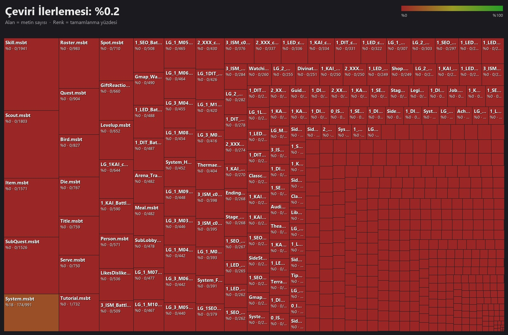

# Fortuna-TR

Bu proje Fire Emblem: Fortune's Weave adlı oyun için yapılmış WIP(Work In Progress) Türkçe çeviri modudur.

## İçindekiler

- [Neden](#neden)
- [Projeyi destekleme](#projeyi-destekleme)
- [Kurulum](#kurulum)

## Neden?

Çünkü sıkıldım ve pcdeki tek çevirmek isteyeceğim oyun buydu.

 Tarik366 17.11.2026 

## Projeyi destekleme

Projeyi desteklemeden önce [Katkı.md](CONTRIBUTING.MD) okuyun

## Kurulum

1. [Fortuna-TR.zip](https://github.com/Tarik366/Fortuna-TR/archive/refs/heads/master.zip) dosyasını indirin

### Emülatör

1. Emülatörünüzdeki oyuna sağ tıklayıp `Open Mod Data Folder` seçeneğiyle mod klasörünü açın
2. Açılan klasöre zipten çıkan Fortuna-TR klasörünü yapıştırın

### Recompile

1. Eğer recompile bir versiyon kullanıyorsanız Recompile launcher'dan `Open Mod Folder` ile mod klasörünü açın
2. Açılan klasöre zipten çıkan Fortuna-TR klasörünü yapıştırın

### Konsol

<!-- TODO:  -->

## İlerleme

